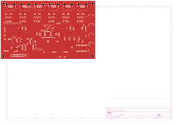
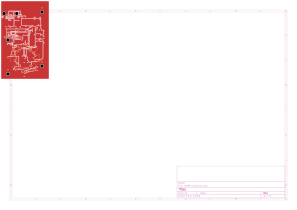
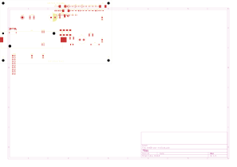
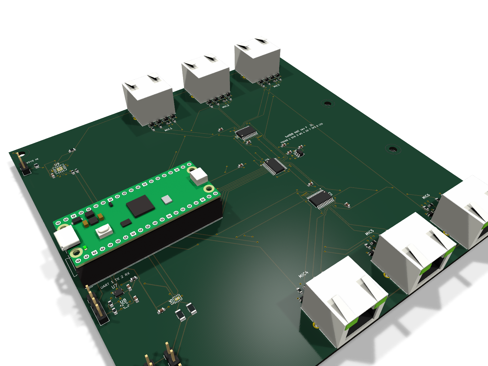
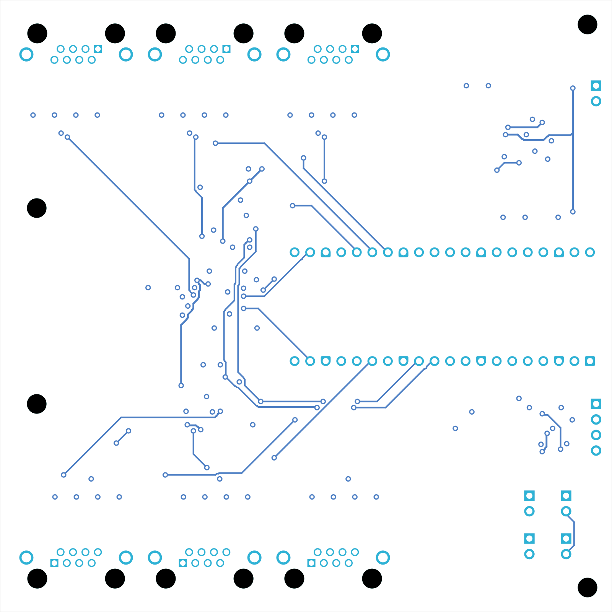

# het68_pcb

Zadání a KiCad návrh PCB pro **het68** (akustická detekce dronů).

Aktuální verze: **[v4.0.0](https://github.com/fedurca/het68_pcb/releases/tag/v4.0.0)** — viz [CHANGELOG.md](CHANGELOG.md). Kusovník v4: [kicad/BOM_v4.csv](kicad/BOM_v4.csv). Poslední Pico-revize: [v3.0.0](https://github.com/fedurca/het68_pcb/releases/tag/v3.0.0).

Firmware a geometrie pole: [fedurca/het68](https://github.com/fedurca/het68). Zadání: [docs/ZADANI_PCB.md](docs/ZADANI_PCB.md). Projekty v KiCadu: [kicad/README.md](kicad/README.md).

## Co to je

v4 je sada **Core 6L + vyměnitelná silová deska + šest satelitů**. Na měď nepřijde 230 V, 22 kV ani 110 kV.

**Core** (`kicad/het68-core`) nese nativní RP2350B, flash, PSRAM, šest RJ45 s LVDS, piezo, env senzor, ADXL355 a `J_MESH` na Heltec WiFi LoRa 32 V3 (868 MHz). MeshCore běží na Heltecu, takže uzel v síti žije, i když DSP spí. `WAKE_DSP` zapíná `+3V3_DIG`. Později stejné sítě osazené pájeným stampem (DNP land).

**Silová deska** má tři SKU se stejným interconnectem 2×10: NN (multiplex CT), VN (silnější GDT/TVS), VVN (harvest CT + Rogowski). Společný front-end je jen sekundár: GDT, TVS, LC, burden, crowbar, MPPT, LiFePO4/LTO, 5 V a vždyživý `+3V3_RF`.

**Satelit** je šest destiček 6L: T5848 uprostřed, **8× SK6812** v kruhu, na kabelu LVDS. SD z mikrofonu jede párem (`SN65LVDS1` na satelitu, `SN65LVDS32` na Core). Mapa [`docs/PINOUT_SAT_v4.csv`](docs/PINOUT_SAT_v4.csv).

HAT pod Pico Plus 2 z v3.0.0 (140 × 140 mm, 2L) zůstává v `kicad/het68-hat` jako poslední vyrobitelná Pico-revize.

## Co je ještě potřeba vyřešit (v4)

1. **Firmware.** `PICO_BOARD` končí. DSP = RP2350B (stejná I²S/LED/piezo GPIO jako HAT rev E). MeshCore na Heltecu: `Heltec_lora32_v3`, UART GPIO5/6, WAKE GPIO7. DSP neovládá SX1262.
2. **6L DRC 0 Core.** QFN-80 0,4 mm chce užší pravidla než 0,25 mm router. v4.0.0 uzavírá schéma a stackup; doroutování je v4.1.0.
3. **Heltec je lab.** ~40–80 mA, ne harvest repeater. Stamp nRF52 později. SCT-013 při 10 A repeater neuživí — LTO povinná, minimální SOC repeateru 30 %.
4. **110 kV.** Žádný externí kabel ze sféry. Anténa U.FL do slotu/pucku u stampu; teď IPEX na Heltecu.
5. **RGB na 3,3 V.** Firmware svítí nejvýš dvěma pixely naráz.

Historický seznam z v3 (HAT / Pico) platí jen pro tag v3.0.0.

## Co je ještě potřeba vyřešit (v3.0.0 HAT, zmrazené)

Schémata v3 mají ERC 0. HAT, satelit v3 a power v3 jsou dvouvrstvé a vejdou se do printed.cz PROTOTYP (max. 200 × 250 mm).

1. **Firmware na pinout rev E.** HAT přesunul SD a LED: `PIN_I2S_SD[6] = { 18, 17, 16, 13, 14, 15 }` pro MIC1–MIC6 a LED_DIN MIC1–MIC6 na GP21, GP20, GP19, GP10, GP11, GP12. Každý SD má vlastní PIO SM, jiná změna ve firmware není potřeba. Bez úpravy firmware čte staré piny a mikrofony mlčí. Proti v2.0.0 se GPIO nemění.
2. **Pouzdro.** HAT je 140 × 140 mm (ve v2.0.0 byl 100 × 100 mm). Jacky jsou ve dvou řadách: MIC1–MIC3 na severní hraně, MIC4–MIC6 na jižní, otvorem ven. USB-C Pica je na západní hraně. Díry M3 jsou na [4; 4], [4; 136], [132; 50] a [132; 90] mm od levého horního rohu. Nosný prstenec se upraví podle STEP v `kicad/het68-hat/fab/`.
3. **Power — harvest front-end je DRC 0.** Burden, LC a crowbar jsou na desce. CN3791, BQ25895, držák 21700 a PAC1934 ve schématu ještě nejsou; bez nich to není kompletní napájení ze zadání.
4. **Stínění satelitu.** Plášť je na GND jen na HAT. Na satelitu je `SH` nezapojený.
5. **LED a I²S sdílejí země v kabelu.** Mapa T568B je zmrazená. Proud diody pořád jede po zemích hodin.
6. **RGB na 3,3 V.** Šest bílých diod se nevejde do 3,3 V z Pica. Firmware má svítit nejvýš dvěma pixely naráz a na zlomek jasu (cíl pod 150 mA na `+3V3_MIC`; INA3221 kanál 2 to měří).
7. **DPS310.** Land pattern je z BMP280 — před výrobou HAT srovnat s C130156. T5848 chce ENIG. SS34 je SMC.

## Vyrobitelnost (v4.0.0)

Na měď nejde 230 V / 22 kV / 110 kV. Gerbery z `kicad-cli` v `kicad/*/fab/`.

| Deska | Rozměr | ERC error | DRC error | Objednat? |
|---|---|---|---|---|
| Core | 160 × 100 mm, 6L Faraday, ENIG | 0 | layout v4.1.0 (QFN-80) | schéma + stackup ano; ne printed.cz PROTOTYP |
| Satelit | 50 × 80 mm, 6L Faraday, ENIG | 0 | layout 6L | schéma ano; ne printed.cz PROTOTYP, 6× |
| Silová NN/VN/VVN | 140 × 80 mm, 2L 70 µm | 0 | layout v4.1.0 | schéma ano; HASL/ENIG dle TPV, ne SKU PROTOTYP |

## Vyrobitelnost (v3.0.0 HAT, zmrazené)

HAT, satelit v3 a power v3 splňují **printed.cz PROTOTYP**: jedna osazená deska, max. 200 × 250 mm, 1 nebo 2 vrstvy, bez SMD 0402 a menších, bez BGA, ENIG (ne HAL), zelená lesklá maska, bílý potisk, obrys frézováním. Cena kategorie je 5 000 Kč za osazenou desku do týdne; součástky dodá zákazník do dvou dnů. LGA/QFN/DFN/WSON (DPS310, SHT40, T5848, INA3221, DRV8837) nejsou BGA. SMT jen nahoře. FR4 1,5 mm, stopa ≥ 0,25 mm, mezera ≥ 0,2 mm, prokovy 0,8 / 0,5 mm.

| Deska | Rozměr | DRC error | Unconnected | Objednat? |
|---|---|---|---|---|
| HAT | 140 × 140 mm, 2L | 0 | 2× zone-to-self na vrcholu GND výplně (není pad) | ano, ENIG, printed.cz PROTOTYP |
| Satelit v3 | 28 × 52 mm, 2L | 0 | 0 | historický tag v3.0.0 |
| Power v3 | 100 × 58 mm, 2L | 0 | 0 | historický harvest front-end |

## Odhad výrobní ceny

Jedna sada = 1 akustická deska + 1 power deska v dnešním zapojení + 6 satelitů + 1 Pico Plus 2. Ceny jsou USD bez dopravy a bez daně, říjen 2026. Nejsou to nabídka výrobce.

V ceně je plošný spoj, economic osazení a součástky na deskách. Mimo cenu jsou čtyři piezoměniče, šest kabelů, kleště SCT-013-000 (maloobchod kolem 9–12 USD) a článek 21700.

Podklady: JLCPCB, 2 vrstvy, do 100 × 100 mm, 5 ks za 2 USD a 10 ks za 5 USD. Od třiceti kusů asi 1,10 USD za desku 100 × 100 mm (srovnání z 23. 8. 2026). U 1000 kusů je v tabulce extrapolace 0,90 USD. ENIG na satelitu je přirážka odhadem 0,75 USD/ks do deseti kusů a 0,40 USD/ks dál. Osazení podle ceníku JLCPCB z 22. 10. 2026: setup 8,18 USD, šablona 1,53 USD a ruční pájení 3,58 USD za každou ze tří desek, 3,07 USD za extended součástku (počítáno 25 typů), 0,0016 USD za SMT spoj (odhad 480 na sadu), 0,0164 USD za vývodový spoj (odhad 140 na sadu), rentgen na 10 bezvývodových pouzder na sadu.

Součástky se známou cenou: Pico Plus 2 asi 14 USD v malém množství (The Pi Hut 12,90 GBP vč. DPH), T5848 podle Mouseru, RJHSE-5380 podle LCSC C464586, SN74LVC8T245PWR podle LCSC C27643. Ostatní pasiva, diody, konektory a senzory bez stažené ceny jsou paušál 8 USD na sadu do 20 kusů, 5,50 USD do 100 kusů a 4 USD při 1000 kusech.

U 1–4 sad se stejně objedná minimum desek (5 + 5 + 10), proto prvních pár kusů nese celý setup.

| Sad | Celkem USD | USD za sadu |
|---:|---:|---:|
| 1 | 200 | 200 |
| 2 | 250 | 125 |
| 3 | 320 | 105 |
| 4 | 380 | 95 |
| 5 | 440 | 88 |
| 10 | 710 | 71 |
| 20 | 1220 | 61 |
| 100 | 4900 | 49 |
| 1000 | 43300 | 43 |

Od v3.0.0 je HAT znovu dvouvrstvý (140 × 140 mm, 0603), takže printed.cz PROTOTYP na všechny tři desky platí: 5 000 Kč za jednu osazenou desku. Sada 1 HAT + 1 power + 6 satelitů je osm objednávek v téhle kategorii. Příprava výroby se při nezměněných podkladech u další série neúčtuje znovu.

U jednoho kusu mimo prototypovou službu je zhruba 16 USD desky, 140 USD osazení (skoro celé jsou to jednorázové poplatky) a 50 USD součástky včetně Pica. Od dvaceti sad začne cenu táhnout Pico, šest mikrofonů a dvanáct stíněných jacků. Rozptyl je klidně ±30 %, dokud není košík: poplatek za feeder závisí na tom, co JLCPCB vede jako Basic. HAT 140 × 140 mm u JLCPCB padne do vyšší rozměrové třídy než 100 × 100 mm.

## Vlastní deska místo Pico Plus 2 W

Dnešní odhad počítá s koupeným Pico Plus 2 bez rádia, asi 14 USD v malém množství. Vlastní deska ve třídě Pico Plus 2 W znamená RP2350B, 16 MB flash, 8 MB PSRAM a CYW43439.

| Dílek | 1 ks | od 100 ks | od 1000 ks | Zdroj |
|---|---:|---:|---:|---|
| RP2350B | 1,20 | 1,00 | 0,90 | Raspberry Pi, ceník čipu |
| CYW43439KUBGT | 5,78 | 4,01 | 4,01 | LCSC C5359496, dál než 100 ks není uvedeno |
| flash 16 MB | 3,42 | 2,14 | 2,10 | LCSC, W25Q128JVPIQ |
| PSRAM 8 MB | 1,93 | 1,58 | 1,52 | LCSC C5360304, APS6404L |
| LDO, krystal, anténa, pasiva | 1,00 | 0,70 | 0,50 | odhad |
| **čipy celkem** | **13,30** | **9,40** | **9,00** | |

Proti 14 USD za koupený modul bez Wi-Fi jsou čipy při jednom kusu skoro stejně drahé a při tisíci kusech asi o 5 USD levnější. K tomu přibude osazení QFN-80 a rádia, rentgen a nejspíš čtyři vrstvy pod CYW43439. Čtyři vrstvy na desce 100 × 100 mm stály v srpnu 2026 u deseti kusů kolem 96 USD proti 5 USD za dvě vrstvy, tedy řádově +9 USD na kus v malé sérii. Když rádio sedí na vlastní malé desce a akustická deska zůstane dvouvrstvá, plošný spoj rádia spadne do stejného prototypového minima 2 USD za pět kusů a na kus vyjde levněji než přepočet celé akustické desky na čtyři vrstvy.

Nová anténa k CYW43439 nemá certifikaci modulů Pimoroni. Jednorázová zkouška rádia se běžně počítá v tisících USD. Při sto kusech je to desítky USD na sadu, při tisíci pořád víc než úspora na čipech.

Bez rádia, jen vlastní náhrada Pico Plus 2 (RP2350B, flash, PSRAM, bez CYW43439), jsou čipy asi 7,50 USD při jednom kusu a asi 5 USD při tisíci. Proti koupeným 14 USD je to úspora kolem 5–6 USD na sadu ještě před osazením QFN-80. Dvouvrstvá deska na to stačí. Rádio z té úspory udělá v malé sérii prodělek.

## Sestava

Kleště / CT jsou na jednom izolovaném vodiči. Na desku jde jen sekundár (burden, LC, crowbar). Panel a článek 21700 jsou u power desky, výstup 5 V jde na HAT, šest satelitů je na RJ45.

## HAT — 140 × 140 mm, 2 vrstvy (rev F)

Pico Plus 2 leží naplocho v západní polovině na dvou zásuvkových lištách 8,5 mm, USB-C na hraně desky. Šest RJ45 je ve dvou řadách otvorem ven: MIC1–MIC3 na severní hraně, MIC4–MIC6 na jižní. Za každým jackem jsou ESD diody, sériové odpory a pull-down na SD. U2 a U3 budí SCK/WS po řadách, U4 převádí šest SD z 1,8 V na 3,3 V. Vlevo nahoře je vstup VSYS a INA3221, vlevo dole UART, DPS310 + SHT40, DRV8837 a čtyři piezo konektory.

Vrstvy: F.Cu signál, B.Cu zemní výplň a napájecí sběrnice. DRC 0, parita schéma ↔ deska 0. KiCad hlásí 2× zone-to-self na vrcholu GND výplně — není to nepřipojený pad. Výrobní data včetně STEP jsou v [`kicad/het68-hat/fab/`](kicad/het68-hat/fab/).

| Signál | GPIO (MIC1 … MIC6) |
|---|---|
| SD | GP18, GP17, GP16, GP13, GP14, GP15 |
| LED_DIN | GP21, GP20, GP19, GP10, GP11, GP12 |
| SCK / WS | GP9 / GP8 (beze změny) |

**Sestava** (Pico Plus 2 na zásuvkových lištách):

**Osazená deska shora:**

**Vrchní měď, potisk, maska:**

**Spodní měď** (zrcadleně, při pohledu zespodu):

## Satelit — 28 × 52 mm, 2 vrstvy

Jeden mikrofon T5848, LDO 1,8 V a adresovatelná RGB dioda. Stejná mapa RJ45 jako na HAT.

**Návrh PCB:**

**Osazená deska:**

## Napájení — 100 × 58 mm, 2 vrstvy

Sekundár CT → THT burden 100 Ω → LC → můstek → crowbar ~25 V, plus USB-C laboratoř. Na desku nejde 230 V ani 22 kV. Panel, 21700 a BQ25895 jsou v `kicad/het68-pwr/BOM_ZDROJE.csv`, ve schématu ještě ne.

**Návrh PCB:**

**Osazená deska:**

