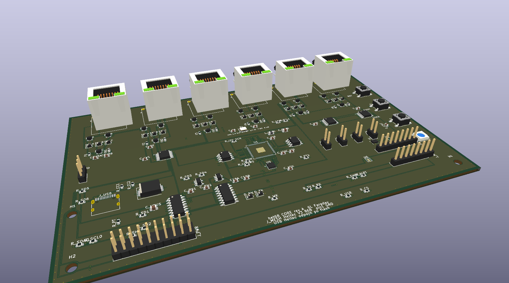
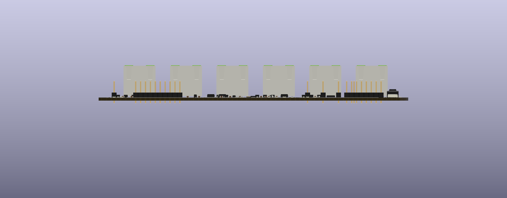
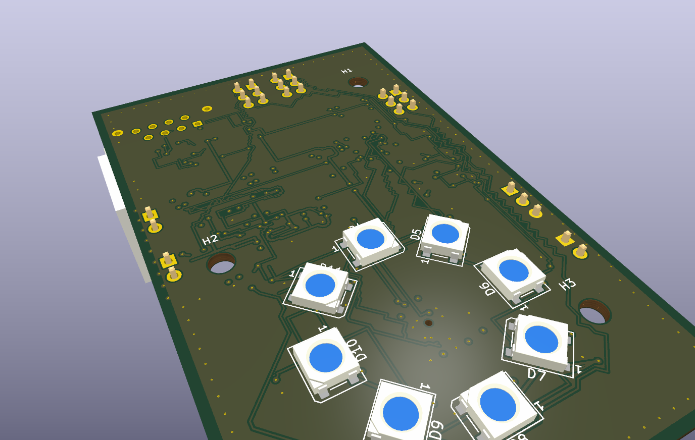
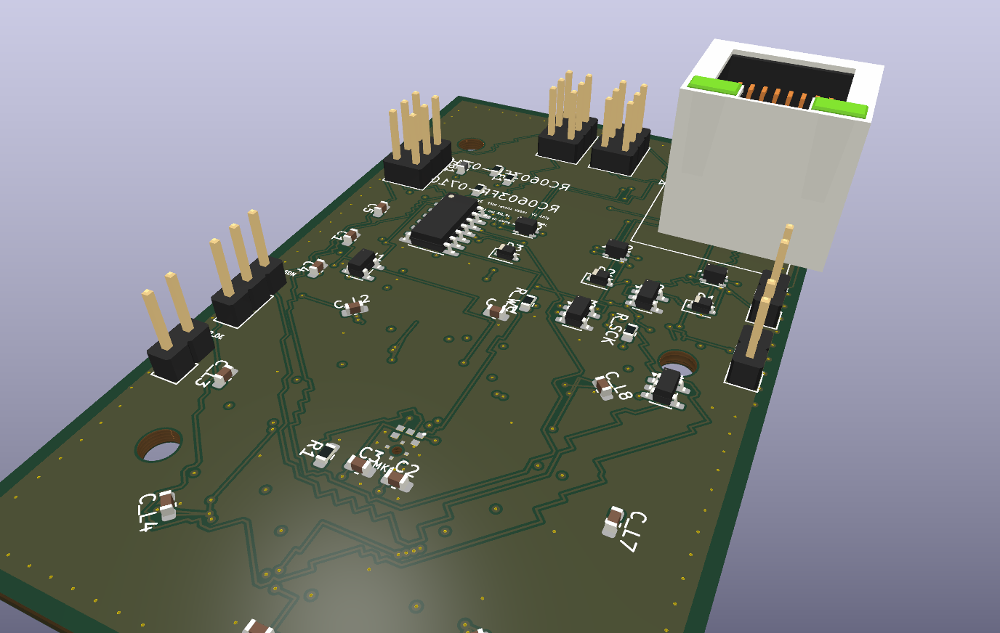
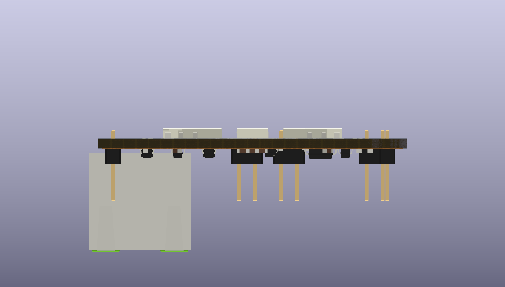
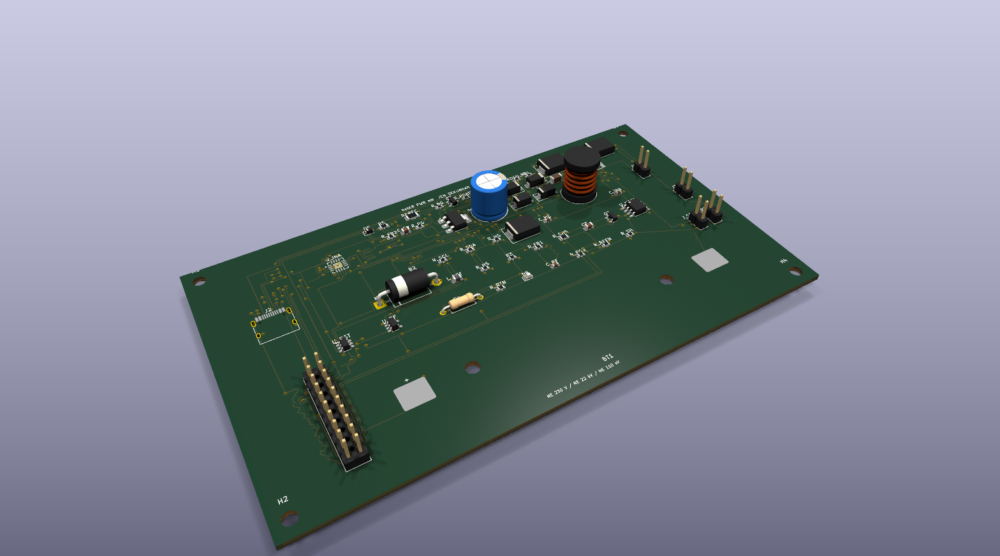

# het68_pcb

Zadání a KiCad návrh PCB pro **het68** (akustická detekce dronů).

Aktuální verze: **[v4.8.0](https://github.com/fedurca/het68_pcb/releases/tag/v4.8.0)** — viz [CHANGELOG.md](CHANGELOG.md). Kusovník sady: [kicad/BOM_KIT.csv](kicad/BOM_KIT.csv). Po deskách: [kicad/BOM_v4.csv](kicad/BOM_v4.csv).

Firmware a geometrie pole: [fedurca/het68](https://github.com/fedurca/het68). Zadání: [docs/ZADANI_PCB.md](docs/ZADANI_PCB.md). Projekty v KiCadu: [kicad/README.md](kicad/README.md).

## Co to je

v4 je sada **Core 6L + vyměnitelná silová deska + šest satelitů**. Na měď nepřijde 230 V, 22 kV ani 110 kV.

**Core** (`kicad/het68-core`) nese nativní RP2350B, flash, PSRAM, USB-C, šest RJ45 s LVDS, piezo, env senzor, ADXL355, stavovou SK6812, tlačítka RESET / BOOT / USER a `J_MESH` na Heltec WiFi LoRa 32 V3 (868 MHz). MeshCore běží na Heltecu, takže uzel v síti žije, i když DSP spí. `WAKE_DSP` zapíná `+3V3_DIG`.

**Silová deska** má tři SKU se stejným interconnectem 2×10: NN (multiplex CT), VN (silnější GDT/TVS), VVN (harvest CT + Rogowski). Společný front-end je jen sekundár: GDT, TVS, LC, burden, crowbar, MPPT, článek 21700 (LiFePO4/LTO), 5 V a vždyživý `+3V3_RF`.

**Satelit** je šest destiček 6L. Ven z desky kouká jen akustický otvor T5848 a kruh **8× SK6812**. Tělo mikrofonu, RJ45 a ostatní elektronika jsou na druhé straně. Režim linky volí propojka na satelitu: diferenciální LVDS, jednostranných 3,3 V, nebo 1,8 V přímo na T5848. Mapa [`docs/PINOUT_SAT_v4.csv`](docs/PINOUT_SAT_v4.csv).

## Prototyp

Náhledy Core a satelitu jsou novější než tag v4.8.0. Ukazují svislý RJ45 a na zadní straně satelitu propojky režimu. Silová deska je náhled z v4.6.0.

Měď: [Core](docs/img/v480/core-top.svg) · [satelit ven](docs/img/v480/sat-front.svg) · [satelit zadek](docs/img/v480/sat-back.svg) · [silová](docs/img/v460/pwr-nn-top.svg). Maska venkovní strany satelitu: [SVG](docs/img/v480/sat-front-mask.svg). Schémata: [Core](docs/img/v480/core-sch.pdf) · [satelit](docs/img/v480/sat-sch.pdf) · [silová](docs/img/v460/pwr-nn-sch.pdf). Gerbery a nastavení formuláře: [`kicad/jlc/`](kicad/jlc/) · [NASTAVENI.md](kicad/jlc/NASTAVENI.md).

## Vyrobitelnost

Na měď nejde 230 V / 22 kV / 110 kV. Gerbery z `kicad-cli` v `kicad/*/fab/`. TPV: JLC / standardní výroba, ENIG na 6L, ≥ 0603, ne BGA. QFN-80 0,4 mm a LGA chtějí ENIG.

| Deska | Rozměr | ERC error | DRC | Objednat? |
|---|---|---|---|---|
| Core | 160 × 100 mm, 6L Faraday, ENIG | 0 | 0 zkratů, 0 mezer, 43 otevřených párů | ne |
| Satelit | 50 × 80 mm, 6L, ven jen LED a port | 0 | 0 zkratů, 19 otevřených párů (dva jsou rohy zemních zón) | ne, dokud nejsou dotažené jack, WS a OE |
| Silová NN/VN/VVN | 140 × 80 mm, 2L 70 µm | 0 | 0 zkratů, otevřené páry 30 / 36 / 26 | ne jako hotový zdroj |

Schémata jsou elektricky uzavřená (ERC 0 chyb). Core vrtá prokov 0,30/0,15 mm, což se do rozteče QFN 0,40 mm vejde, a L4 pod procesorem je plocha `+3V3_DIG`. DRC Core nemá zkrat ani mezeru. Otevřených je 43 párů. Část z nich je původní únik z prstence QFN, zbytek jsou vývody svislého RJ45 a stopy, které nová rozteč pinů přerušila. Satelit nemá zkrat. Vzdušné zůstávají `LED` a část `SD` u jacku, `OE`, krátká mezera `SD_3V3` u `U5` a sítě slovního taktu (`WS_LVDS`, `WS_P`, `WS_T`, `WS_N`). Dva záznamy jsou rohy zemních zón.

## VF / EMC (silné rušení)

- 6L Faraday: L2/L5 souvislá GND. Na Core je L4 jedna plocha `+3V3_DIG`. Silové desky mají L4 rozdělené. Stitch po obvodu.
- Diferenciální režim vozí I²S po LVDS (T568B páry). Propojka na satelitu umí i jednostranných 3,3 V a 1,8 V. Stínění je na GND na Core i na satelitu.
- CMC na SCK, WS i SD na obou koncích; nízko-kapacitní TVS napříč párem; 100 Ω u přijímače (SN65LVDS2 / SN65LVDS32 nemají vnitřní zakončení).
- Ferit 600 Ω na 3V3 každého jacku a na satelitu za PPTC.
- Krystal 12 MHz s C0G 15 pF (ne X7R 100 nF). Sériové 33 Ω na I²S u MCU, 22 Ω + ESD na UART MeshCore.
- Rádio (SX1262) je na Heltecu mimo DSP; `+3V3_RF` je vždyživé a oddělené od hradlovaného `+3V3_DIG`.

## Co je ještě potřeba

1. **Firmware.** DSP = RP2350B. MeshCore na Heltecu: `Heltec_lora32_v3`, UART GPIO5/6, WAKE GPIO7.
2. **Dokončit střední piny QFN-80** (QSPI SD2/SD3, část LED, SWD, UART) a zbylé LVDS páry. Silová deska má překryté pady z rozmístění.
3. **Heltec je lab.** ~40–80 mA. Stamp nRF52 později. LTO povinná, minimální SOC repeateru 30 %.
4. **110 kV.** Žádný externí kabel ze sféry. Anténa U.FL do slotu u stampu.
5. **RGB na 3,3 V.** Firmware svítí nejvýš dvěma pixely naráz.

## Sestava

Kleště / CT jsou na jednom izolovaném vodiči. Na desku jde jen sekundár (burden, LC, crowbar). Panel a článek LiFePO4/LTO jsou u silové desky, výstup `+5V_ALWAYS` jde na Core, šest satelitů je na RJ45.
