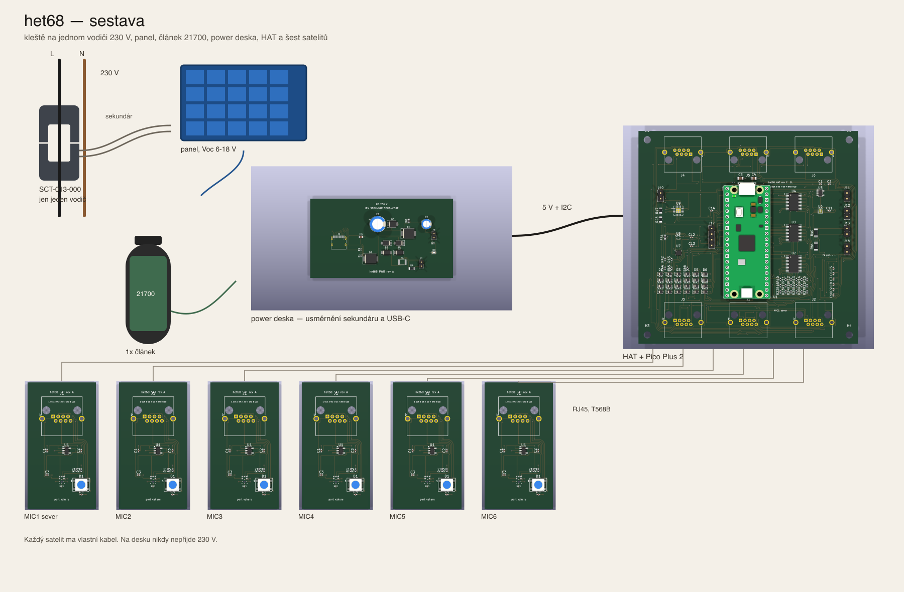
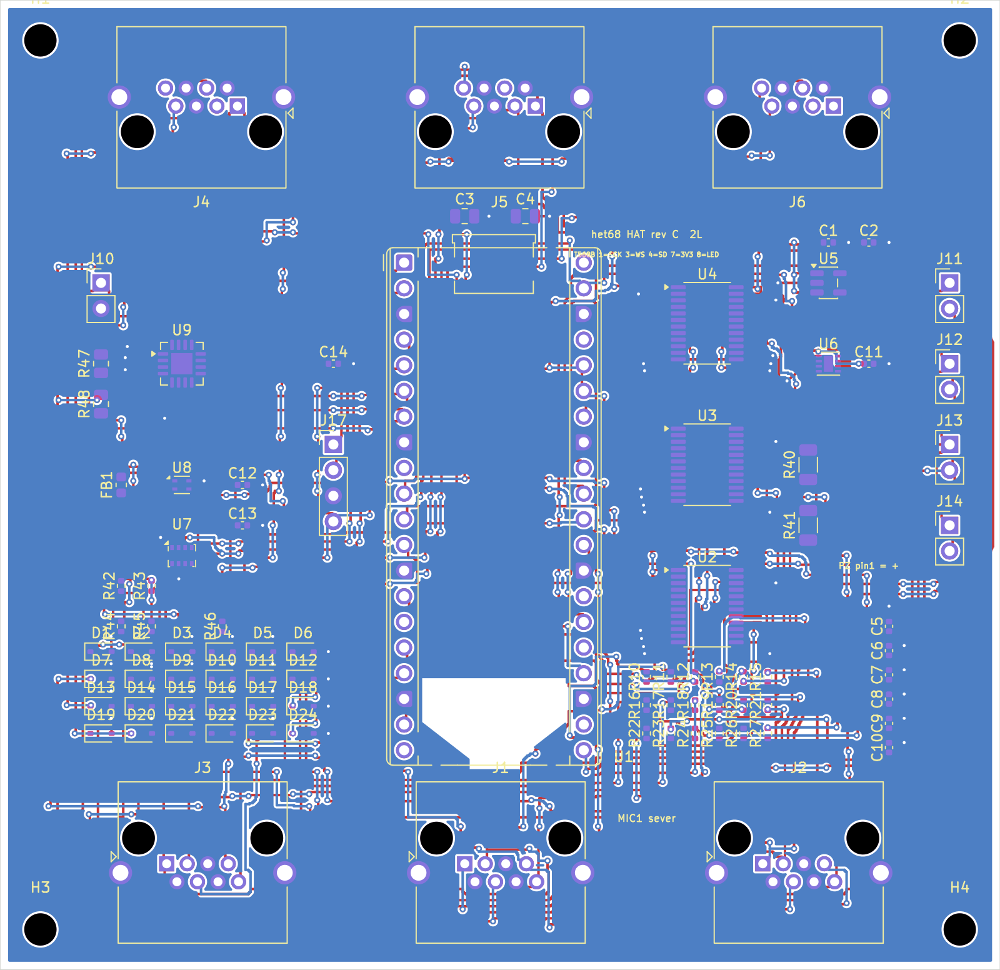
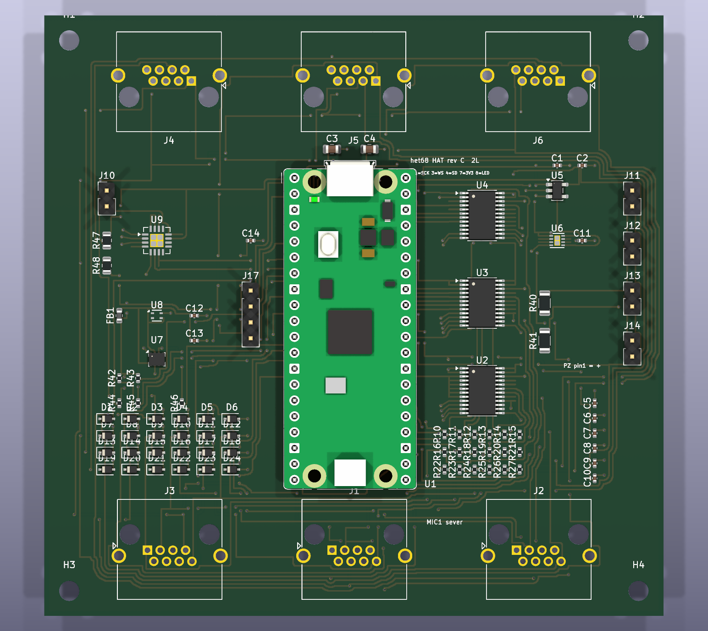
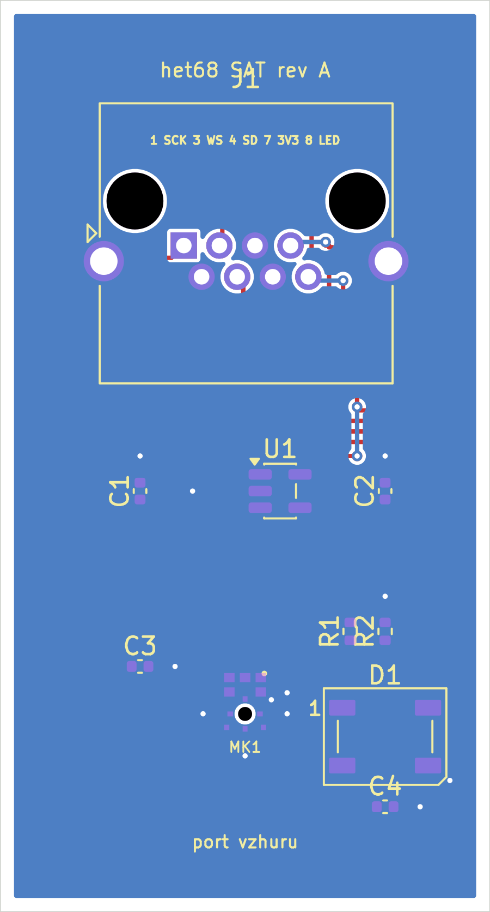
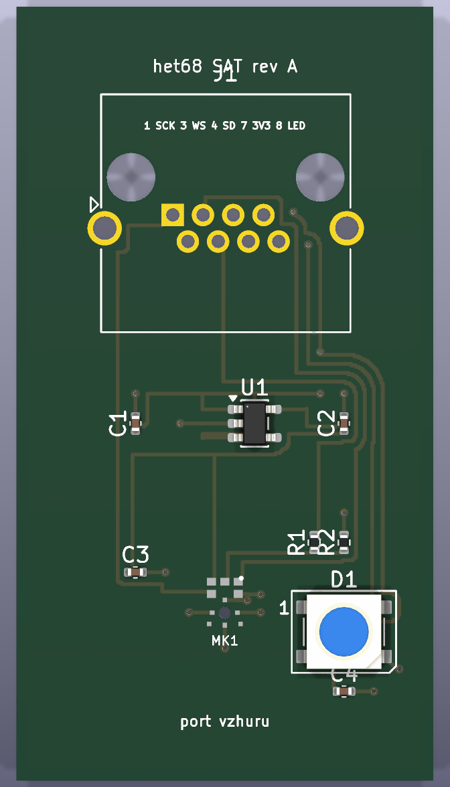
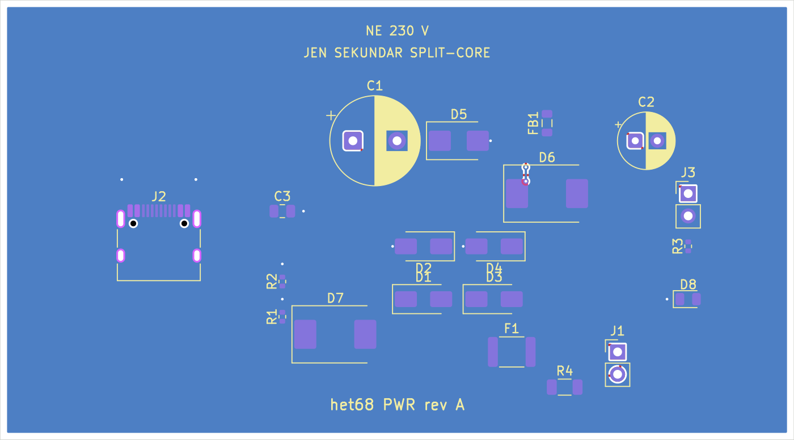
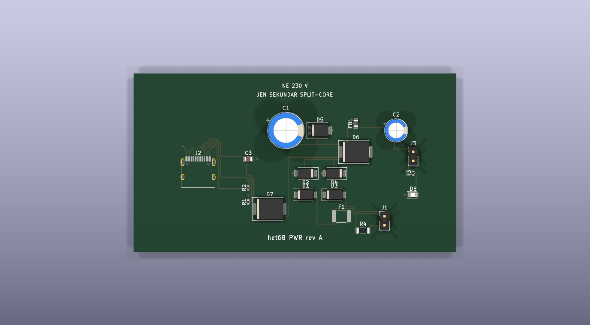

# het68_pcb

Zadání a KiCad návrh PCB pro **het68** (akustická detekce dronů).

Aktuální verze: **[v1.7.0](https://github.com/fedurca/het68_pcb/releases/tag/v1.7.0)** — viz [CHANGELOG.md](CHANGELOG.md). Kusovník: [kicad/BOM.csv](kicad/BOM.csv).

Firmware a geometrie pole: [fedurca/het68](https://github.com/fedurca/het68). Zadání pro návrháře: [docs/ZADANI_PCB.md](docs/ZADANI_PCB.md). Projekty v KiCadu: [kicad/README.md](kicad/README.md).

Tři desky: HAT k Pimoroni Pico Plus 2, satelit mikrofonu (6×) a napájení ze sekundáru split-core. Satelit je v DRC čistý. Power nemá zkraty; na USB-C zbývá jedna mezera VBUS. HAT nemá zkraty ani vůle, část sítí ale pořád není spojená. Do výroby až po dočištění HAT a VBUS.

## Sestava

Kleště jsou na jednom izolovaném vodiči obvodu 230 V. Na desku jde jen sekundár. Panel a článek 21700 jsou u power desky, výstup 5 V jde na HAT, šest satelitů je na RJ45.

## HAT — 99 × 96 mm, 2 vrstvy

Pico Plus 2 uprostřed, šest RJ45, převodníky I²S, budič čtyř piez, DPS310, SHT40 a INA3221.

**Návrh PCB** (vrchní měď, potisk, maska):

**Osazená deska:**

## Satelit — 28 × 52 mm, 2 vrstvy

Jeden mikrofon T5848, LDO 1,8 V a adresovatelná RGB dioda. Stejná mapa RJ45 jako na HAT.

**Návrh PCB:**

**Osazená deska:**

## Napájení — 90 × 50 mm, 2 vrstvy

Sekundár split-core, můstek, TVS a diodové OR s USB-C. Na desce není 230 V. Specifikace další revize (panel, 21700, výstup 5 V) je v zadání a v `kicad/het68-pwr/BOM_ZDROJE.csv`; na obrázku je pořád jen usměrnění.

**Návrh PCB:**

**Osazená deska:**

