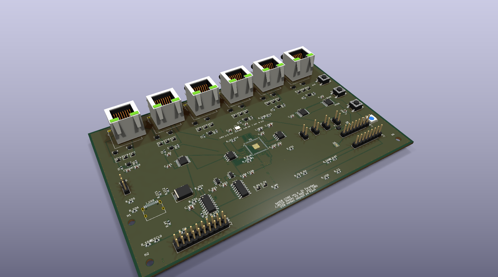
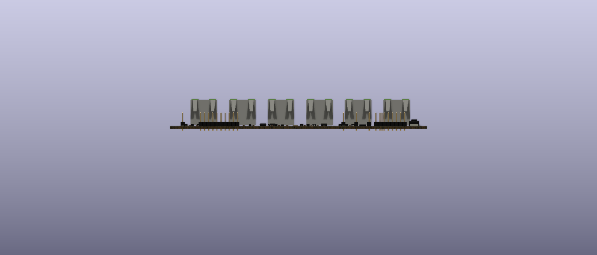
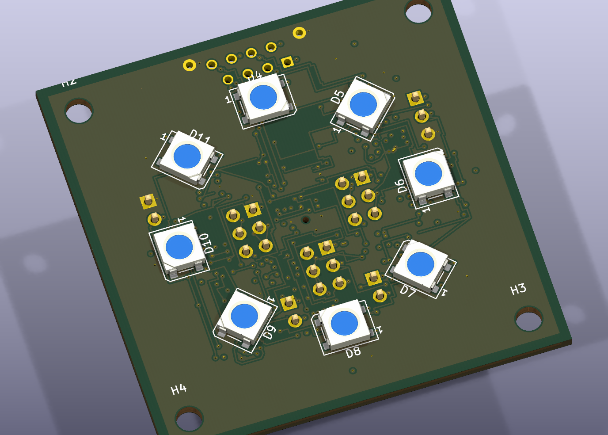
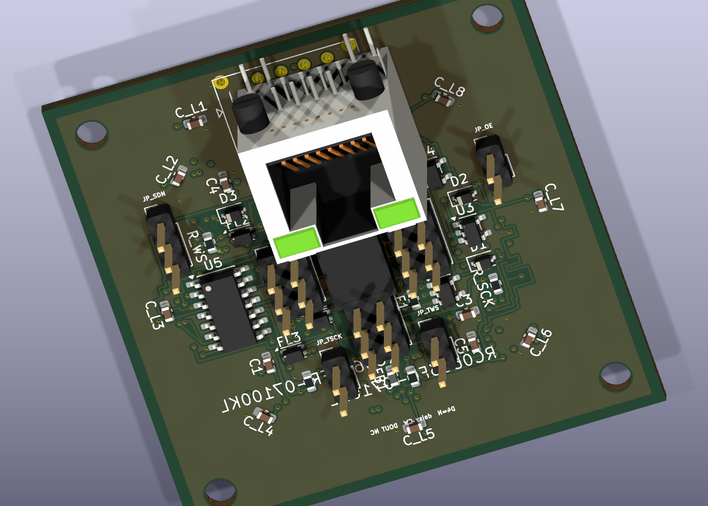
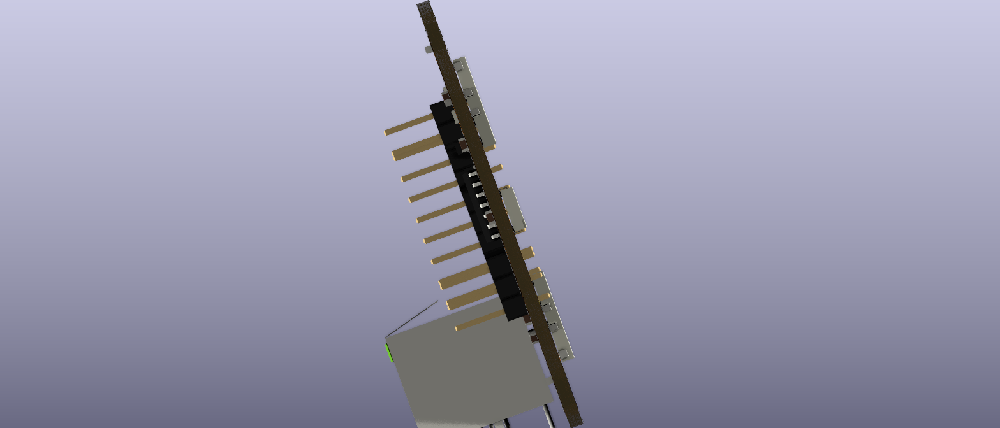
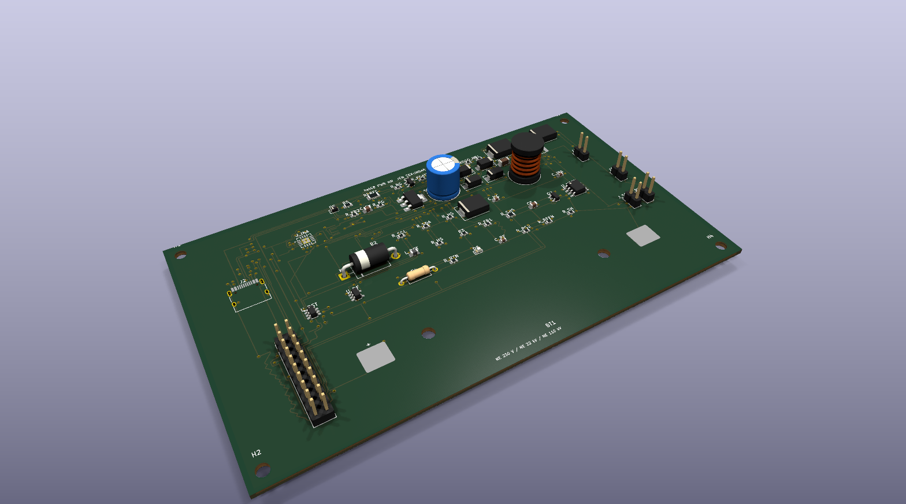

# het68_pcb

Zadání a KiCad návrh PCB pro **het68** (akustická detekce dronů).

Co ještě zbývá před zadáním do výroby, včetně testovatelnosti a odolnosti proti rušení: [problems.md](problems.md).

Aktuální verze: **[v7.4.3](https://github.com/fedurca/het68_pcb/releases/tag/v7.4.3)** — viz [CHANGELOG.md](CHANGELOG.md). Kusovník sady: [kicad/BOM_KIT.csv](kicad/BOM_KIT.csv). Po deskách: [kicad/BOM_v4.csv](kicad/BOM_v4.csv).

Firmware a geometrie pole: [fedurca/het68](https://github.com/fedurca/het68). Zadání: [docs/ZADANI_PCB.md](docs/ZADANI_PCB.md). Projekty v KiCadu: [kicad/README.md](kicad/README.md).

## Co to je

v4 je sada **Core 8L + vyměnitelná silová deska + šest satelitů**. Na měď nepřijde 230 V, 22 kV ani 110 kV.

**Core** (`kicad/het68-core`) nese nativní RP2350B, flash, PSRAM, USB-C, šest RJ45 s LVDS, piezo, env senzor, stavovou SK6812 na 5 V, tlačítka RESET / BOOT / USER a `J_MESH` na Heltec WiFi LoRa 32 V3 (868 MHz). Akcelerometr na desce není. MeshCore běží na Heltecu, takže uzel v síti žije, i když DSP spí. `WAKE_DSP` zapíná `+3V3_DIG`.

**Silová deska** má tři SKU se stejným interconnectem 2×10: NN (multiplex CT), VN (silnější GDT/TVS), VVN (harvest CT + Rogowski). Společný front-end je jen sekundár: GDT, TVS, LC, burden, crowbar, MPPT, článek 21700 (LiFePO4/LTO), 5 V a vždyživý `+3V3_RF`.

**Satelit** je šest čtverců 52 × 52 mm, 8L. Mikrofon je uprostřed, kolem něj kruh **8× SK6812**. Svislý RJ45 a konfigurační propojky jsou na zadní straně co nejblíž středu. Režim linky volí propojka: diferenciální LVDS, jednostranných 3,3 V, nebo 1,8 V přímo na T5848. Význam propojek a postup osazení: [docs/SATELIT.md](docs/SATELIT.md). Mapa [`docs/PINOUT_SAT_v4.csv`](docs/PINOUT_SAT_v4.csv).

## Prototyp

Náhled satelitu je z v7.4.2. Core a silová deska mají stejnou měď jako ve v7.3.0.

Měď: [Core](docs/img/v740/core-top.svg) · [satelit ven](docs/img/v742/sat-front.svg) · [satelit zadek](docs/img/v742/sat-back.svg) · [silová](docs/img/v740/pwr-nn-top.svg). Maska venkovní strany satelitu: [SVG](docs/img/v742/sat-front-mask.svg). Schémata: [Core](docs/img/v740/core-sch.pdf) · [satelit](docs/img/v740/sat-sch.pdf) · [silová](docs/img/v740/pwr-nn-sch.pdf). Gerbery a nastavení formuláře: [`kicad/jlc/`](kicad/jlc/) · [NASTAVENI.md](kicad/jlc/NASTAVENI.md).

## Vyrobitelnost

Na měď nejde 230 V / 22 kV / 110 kV. Gerbery z `kicad-cli` v `kicad/*/fab/`. TPV: JLC / standardní výroba, ENIG na 6L a 8L, ≥ 0603, ne BGA. QFN-80 0,4 mm a LGA chtějí ENIG.

| Deska | Rozměr | ERC error | DRC | Objednat? |
|---|---|---|---|---|
| Core | 160 × 100 mm, 8L Faraday, ENIG | 0 | 0 zkratů, 0 mezer, 0 otevřených párů | měď ano; stroj osadí 111 součástek, dva LVDS přijímače ručně |
| Satelit | 52 × 52 mm, 8L, ven jen LED | 0 | 0 zkratů, 0 mezer, 0 otevřených párů | měď ano |
| Silová NN/VN/VVN | 140 × 80 mm, 6L, vnější měď 2 oz pokud kalkulace umí | 0 | 0 zkratů, 0 mezer, 0 otevřených párů | měď ano; stroj osadí 49 / 50 / 48 součástek z horní strany |

Schémata jsou elektricky uzavřená (ERC 0 chyb). Core je 8vrstvá: mezi GND_L5 a GND_L7 je SIG_L6 pro páry LVDS. Prokov je 0,30/0,15 mm. Satelit je čtverec 52 mm, 8 vrstev, prokov 0,60/0,20 mm. Mikrofon je ve středu, RJ45 a režimové propojky jsou na zadní straně hned u něj. Signálové sítě jsou spojené, delší spoje jdou po SIG_L6. Silové desky jsou 6vrstvé: F.Cu / GND_L2 / SIG_L3 / SIG_L4 / GND_L5 / B.Cu. Silové stopy jsou na vnější mědi, I2C a sense na vnitřní vrstvě. Stitch prokov je 1,00/0,50 mm, únik z jemného rastru 0,80/0,40 mm.

## VF / EMC (silné rušení)

- Core je 8L Faraday: L2, L5 a L7 jsou souvislá GND, L4 je plocha `+3V3_DIG` a nese i několik signálů, které mezi prokovy QFN jinde neprošly. L6 je signál mezi dvěma zeměmi. Zem je prošitá po obvodu s roztečí 1,5 mm. Satelit je 8L se stejným principem: SIG_L6 leží mezi GND_L5 a GND_L7. Silová deska je 6L, sense a I2C jdou mezi GND_L2 a GND_L5.
- Diferenciální režim vozí I²S po LVDS (T568B páry). Propojka na satelitu umí i jednostranných 3,3 V a 1,8 V. Stínění je na GND na Core i na satelitu.
- CMC na SCK, WS i SD na obou koncích; nízko-kapacitní TVS napříč párem; 100 Ω u přijímače (SN65LVDS2 / SN65LVDS32 nemají vnitřní zakončení).
- Ferit 600 Ω na 3V3 každého jacku a na satelitu za PPTC.
- Krystal 12 MHz s C0G 15 pF (ne X7R 100 nF). Sériové 33 Ω na I²S u MCU, 22 Ω + ESD na UART MeshCore.
- Rádio (SX1262) je na Heltecu mimo DSP; `+3V3_RF` je vždyživé a oddělené od hradlovaného `+3V3_DIG`.

## Co je ještě potřeba

1. **Firmware.** DSP = RP2350B. MeshCore na Heltecu: `Heltec_lora32_v3`, UART GPIO5/6, WAKE GPIO7.
2. **Core je uzavřené.** QFN, LVDS i silová deska mají měď dotaženou. Osazení silové desky a satelitu čeká na katalogové LCSC, kódy se nedoplňují odhadem.
3. **Heltec je lab.** ~40–80 mA. Stamp nRF52 později. LTO povinná, minimální SOC repeateru 30 %.
4. **110 kV.** Žádný externí kabel ze sféry. Anténa U.FL do slotu u stampu.
5. **RGB na 3,3 V.** Firmware svítí nejvýš dvěma pixely naráz.

## Sestava

Kleště / CT jsou na jednom izolovaném vodiči. Na desku jde jen sekundár (burden, LC, crowbar). Panel a článek LiFePO4/LTO jsou u silové desky, výstup `+5V_ALWAYS` jde na Core, šest satelitů je na RJ45.
