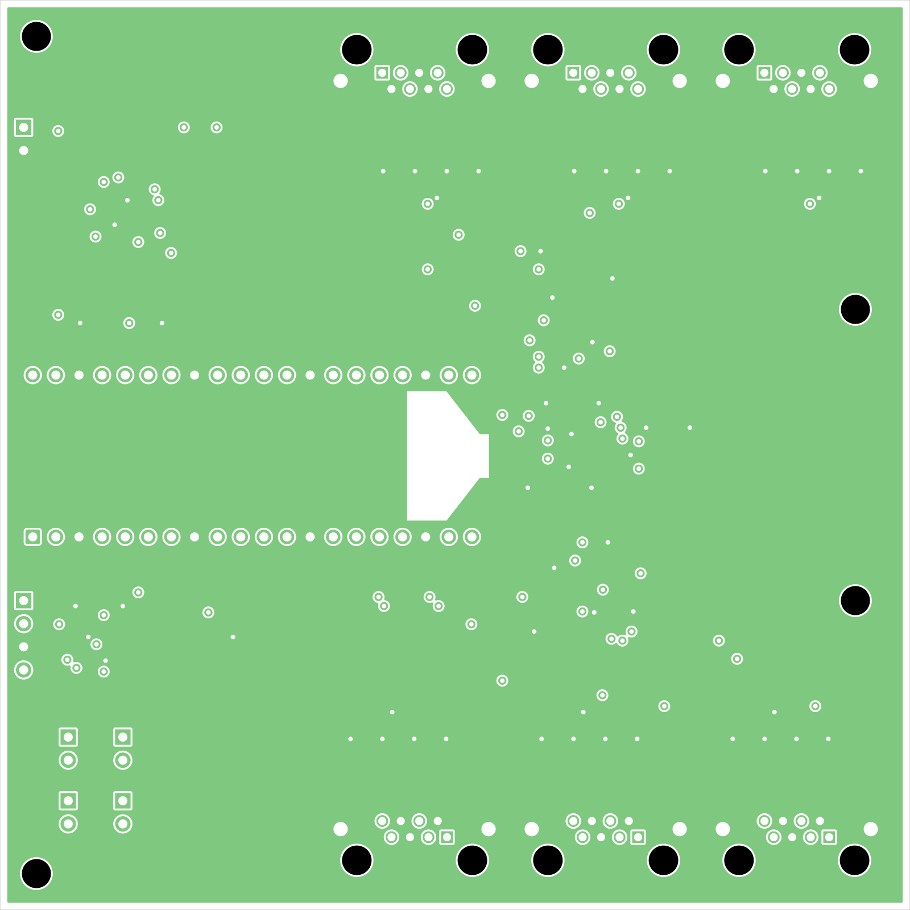
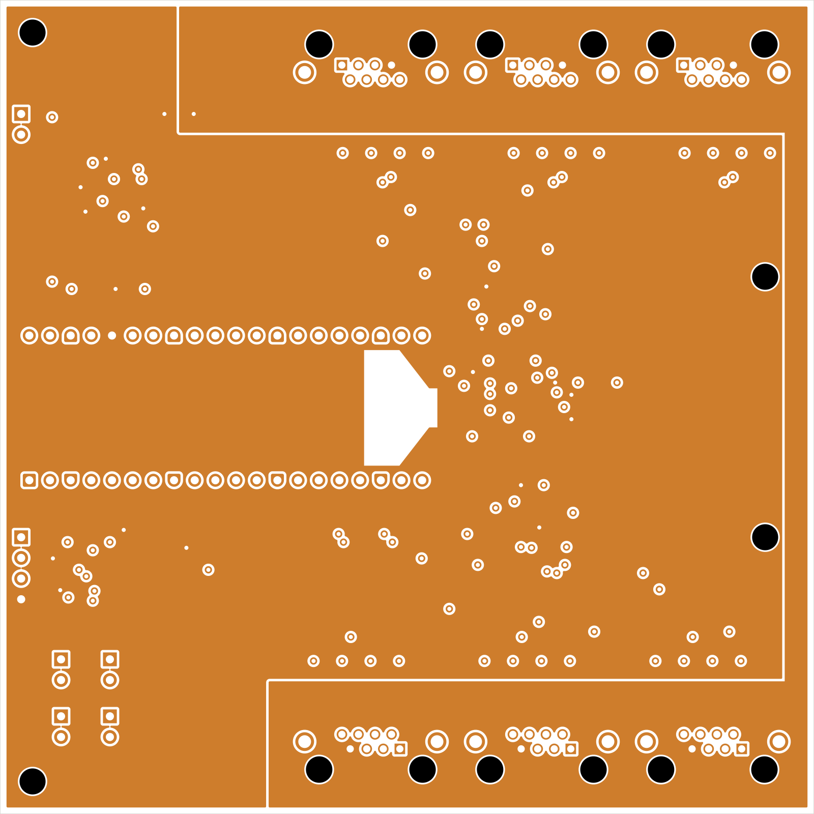

# het68_pcb

Zadání a KiCad návrh PCB pro **het68** (akustická detekce dronů).

Aktuální verze: **[v2.0.0](https://github.com/fedurca/het68_pcb/releases/tag/v2.0.0)** — viz [CHANGELOG.md](CHANGELOG.md). Kusovník: [kicad/BOM.csv](kicad/BOM.csv).

Firmware a geometrie pole: [fedurca/het68](https://github.com/fedurca/het68). Zadání pro návrháře: [docs/ZADANI_PCB.md](docs/ZADANI_PCB.md). Projekty v KiCadu: [kicad/README.md](kicad/README.md).

## Co to je

Tři desky.

**Power deska** (100 × 58 mm) bere sekundár CT / kleští (ne 230 V ani 22 kV na desku), USB-C jako laboratorní vstup, a později panel + 21700. Na nakreslené desce je teď: THT burden 100 Ω trvale na J1, LC filtr před usměrňovačem, můstek, crowbar ~25 V (SCR X0202MN + Zener BZX84-C24) a výstup přes ferit. MPPT, nabíječka a PAC1934 jsou v kusovníku, ve schématu ještě ne.

**Akustická deska** je HAT pod Pimoroni Pico Plus 2 (100 × 100 mm, 4 vrstvy). Nese šest RJ45 ve dvou řadách, převodníky I²S, budič čtyř piezoměničů, DPS310, SHT40 a INA3221. Piezoměniče jsou signalizace na téhle desce, ne v satelitech.

**Satelit** je šest stejných destiček, každá na vlastním kabelu. Na každé je mikrofon T5848, LDO 1,8 V a jedna adresovatelná RGB dioda.

## Co je ještě potřeba vyřešit

Schémata mají ERC 0 chyb. HAT je čtyřvrstvý, satelit a power dvouvrstvé, vše 1,6 mm.

1. **Firmware na pinout rev E.** HAT přesunul SD a LED: `PIN_I2S_SD[6] = { 18, 17, 16, 13, 14, 15 }` pro MIC1–MIC6 a LED_DIN MIC1–MIC6 na GP21, GP20, GP19, GP10, GP11, GP12. Každý SD má vlastní PIO SM, jiná změna ve firmware není potřeba. Bez úpravy firmware čte staré piny a mikrofony mlčí.
2. **Pouzdro.** Jacky jsou ve dvou řadách: MIC1–MIC3 na severní hraně HAT, MIC4–MIC6 na jižní, otvorem ven. USB-C Pica je na západní hraně. Díry M3 jsou na [4; 4], [4; 96], [94; 34] a [94; 66] mm od levého horního rohu. Nosný prstenec se upraví podle STEP v `kicad/het68-hat/fab/`.
3. **Power — harvest front-end je DRC 0.** Burden, LC a crowbar jsou na desce. CN3791, BQ25895, držák 21700 a PAC1934 ve schématu ještě nejsou; bez nich to není kompletní napájení ze zadání.
4. **Stínění satelitu.** Plášť je na GND jen na HAT. Na satelitu je `SH` nezapojený.
5. **LED a I²S sdílejí země v kabelu.** Mapa T568B je zmrazená. Proud diody pořád jede po zemích hodin.
6. **RGB na 3,3 V.** Šest bílých diod se nevejde do 3,3 V z Pica. Firmware má svítit nejvýš dvěma pixely naráz a na zlomek jasu (cíl pod 150 mA na `+3V3_MIC`; INA3221 kanál 2 to měří).
7. **DPS310.** Land pattern je z BMP280 — před výrobou HAT srovnat s C130156. T5848 chce ENIG. SS34 je SMC.
8. **Vrtání satelitu a power.** Mají prokovy 0,3 mm. U výrobce s nejlevnější třídou „vrtání > 0,5 mm“ je objednat ve třídě 0,3 mm, nebo je přegenerovat s prokovy 0,5 mm jako HAT. JLCPCB 0,3 mm bere bez příplatku.

## Vyrobitelnost

Proces je běžný. Všechny desky mají do 100 × 100 mm a SMT jen na horní straně. HAT má 4 vrstvy, satelit a power 2. RJ45, hřebínky, zásuvkové lišty Pica, THT burden, tlumivka a radiální kondenzátory jsou vývodové. QFN, LGA, DFN a SOT-223 crowbaru potřebují běžné SMT / rentgen podle pouzdra. Satelit chce ENIG, HAT a power stačí HASL.

HAT vychází z nejlevnější třídy běžného výrobce: stopa ≥ 0,25 mm, mezera ≥ 0,2 mm (čára/mezera ≥ 200/200 µm), nejmenší vrták 0,5 mm (prokovy 0,9/0,5 mm), 127 prokovů, 79 SMD a 13 THT součástek.

| Deska | DRC error | Unconnected | Objednat Gerbery? |
|---|---|---|---|
| HAT | 0 | 0 | ano, 4 vrstvy |
| Satelit | 0 | 0 | ano, ENIG, 6× |
| Power | 0 | 0 | ano jen pro harvest front-end; bez MPPT/BQ |

## Odhad výrobní ceny

Jedna sada = 1 akustická deska + 1 power deska v dnešním zapojení + 6 satelitů + 1 Pico Plus 2. Ceny jsou USD bez dopravy a bez daně, říjen 2026. Nejsou to nabídka výrobce.

V ceně je plošný spoj, economic osazení a součástky na deskách. Mimo cenu jsou čtyři piezoměniče, šest kabelů, kleště SCT-013-000 (maloobchod kolem 9–12 USD) a článek 21700.

Podklady: JLCPCB, 2 vrstvy, do 100 × 100 mm, 5 ks za 2 USD a 10 ks za 5 USD. Od třiceti kusů asi 1,10 USD za desku 100 × 100 mm (srovnání z 23. 8. 2026). U 1000 kusů je v tabulce extrapolace 0,90 USD. ENIG na satelitu je přirážka odhadem 0,75 USD/ks do deseti kusů a 0,40 USD/ks dál. Osazení podle ceníku JLCPCB z 22. 10. 2026: setup 8,18 USD, šablona 1,53 USD a ruční pájení 3,58 USD za každou ze tří desek, 3,07 USD za extended součástku (počítáno 25 typů), 0,0016 USD za SMT spoj (odhad 480 na sadu), 0,0164 USD za vývodový spoj (odhad 140 na sadu), rentgen na 10 bezvývodových pouzder na sadu.

Součástky se známou cenou: Pico Plus 2 asi 14 USD v malém množství (The Pi Hut 12,90 GBP vč. DPH), T5848 podle Mouseru, RJHSE-5380 podle LCSC C464586, SN74LVC8T245PWR podle LCSC C27643. Ostatní pasiva, diody, konektory a senzory bez stažené ceny jsou paušál 8 USD na sadu do 20 kusů, 5,50 USD do 100 kusů a 4 USD při 1000 kusech.

U 1–4 sad se stejně objedná minimum desek (5 + 5 + 10), proto prvních pár kusů nese celý setup.

| Sad | Celkem USD | USD za sadu |
|---:|---:|---:|
| 1 | 200 | 200 |
| 2 | 250 | 125 |
| 3 | 320 | 105 |
| 4 | 380 | 95 |
| 5 | 440 | 88 |
| 10 | 710 | 71 |
| 20 | 1220 | 61 |
| 100 | 4900 | 49 |
| 1000 | 43300 | 43 |

Tabulka je ještě pro dvouvrstvý HAT. Od v2.0.0 má HAT čtyři vrstvy; podle srovnání níže (čtyři vrstvy 100 × 100 mm za ~96 USD / 10 ks proti 5 USD za dvě) přidá deska HAT v malé sérii řádově +9 USD na sadu, v tisícové sérii jednotky USD. U českého výrobce stojí dvouvrstvá 100 × 100 mm při 100 ks 126 Kč/ks plus 650 Kč příprava dat (galvanické zlato, 1,5 mm, bez potisku); čtyřvrstvou je potřeba nacenit zvlášť. Jeho prototypová služba bere jen jedno- a dvouvrstvé desky bez pouzder 0402, na HAT tedy neplatí.

U jednoho kusu je zhruba 16 USD desky, 140 USD osazení (skoro celé jsou to jednorázové poplatky) a 50 USD součástky včetně Pica. Od dvaceti sad začne cenu táhnout Pico, šest mikrofonů a dvanáct stíněných jacků. Rozptyl je klidně ±30 %, dokud není košík: poplatek za feeder závisí na tom, co JLCPCB vede jako Basic. Akustická deska má 100 × 100 mm, pořád v cenové hranici JLCPCB do 100 × 100 mm.

## Vlastní deska místo Pico Plus 2 W

Dnešní odhad počítá s koupeným Pico Plus 2 bez rádia, asi 14 USD v malém množství. Vlastní deska ve třídě Pico Plus 2 W znamená RP2350B, 16 MB flash, 8 MB PSRAM a CYW43439.

| Dílek | 1 ks | od 100 ks | od 1000 ks | Zdroj |
|---|---:|---:|---:|---|
| RP2350B | 1,20 | 1,00 | 0,90 | Raspberry Pi, ceník čipu |
| CYW43439KUBGT | 5,78 | 4,01 | 4,01 | LCSC C5359496, dál než 100 ks není uvedeno |
| flash 16 MB | 3,42 | 2,14 | 2,10 | LCSC, W25Q128JVPIQ |
| PSRAM 8 MB | 1,93 | 1,58 | 1,52 | LCSC C5360304, APS6404L |
| LDO, krystal, anténa, pasiva | 1,00 | 0,70 | 0,50 | odhad |
| **čipy celkem** | **13,30** | **9,40** | **9,00** | |

Proti 14 USD za koupený modul bez Wi-Fi jsou čipy při jednom kusu skoro stejně drahé a při tisíci kusech asi o 5 USD levnější. K tomu přibude osazení QFN-80 a rádia, rentgen a nejspíš čtyři vrstvy pod CYW43439. Čtyři vrstvy na desce 100 × 100 mm stály v srpnu 2026 u deseti kusů kolem 96 USD proti 5 USD za dvě vrstvy, tedy řádově +9 USD na kus v malé sérii. Když rádio sedí na vlastní malé desce a akustická deska zůstane dvouvrstvá, plošný spoj rádia spadne do stejného prototypového minima 2 USD za pět kusů a na kus vyjde levněji než přepočet celé akustické desky na čtyři vrstvy.

Nová anténa k CYW43439 nemá certifikaci modulů Pimoroni. Jednorázová zkouška rádia se běžně počítá v tisících USD. Při sto kusech je to desítky USD na sadu, při tisíci pořád víc než úspora na čipech.

Bez rádia, jen vlastní náhrada Pico Plus 2 (RP2350B, flash, PSRAM, bez CYW43439), jsou čipy asi 7,50 USD při jednom kusu a asi 5 USD při tisíci. Proti koupeným 14 USD je to úspora kolem 5–6 USD na sadu ještě před osazením QFN-80. Dvouvrstvá deska na to stačí. Rádio z té úspory udělá v malé sérii prodělek.

## Sestava

Kleště / CT jsou na jednom izolovaném vodiči. Na desku jde jen sekundár (burden, LC, crowbar). Panel a článek 21700 jsou u power desky, výstup 5 V jde na HAT, šest satelitů je na RJ45.

## HAT — 100 × 100 mm, 4 vrstvy (rev E)

Pico Plus 2 leží naplocho v západní polovině na dvou zásuvkových lištách 8,5 mm, USB-C na hraně desky. Šest RJ45 je ve dvou řadách otvorem ven: MIC1–MIC3 na severní hraně, MIC4–MIC6 na jižní. Za každým jackem jsou ESD diody, sériové odpory a pull-down na SD. U2 a U3 budí SCK/WS po řadách, U4 převádí šest SD z 1,8 V na 3,3 V. Vlevo nahoře je vstup VSYS a INA3221, vlevo dole UART, DPS310 + SHT40, DRV8837 a čtyři piezo konektory.

Vrstvy: F.Cu signál, In1 plná zem, In2 3V3 s ostrovem `+3V3_MIC` pod jacky, B.Cu signál. DRC 0, nepřipojené 0, parita schéma ↔ deska 0. Výrobní data včetně STEP jsou v [`kicad/het68-hat/fab/`](kicad/het68-hat/fab/).

| Signál | GPIO (MIC1 … MIC6) |
|---|---|
| SD | GP18, GP17, GP16, GP13, GP14, GP15 |
| LED_DIN | GP21, GP20, GP19, GP10, GP11, GP12 |
| SCK / WS | GP9 / GP8 (beze změny) |

**Sestava** (Pico Plus 2 na zásuvkových lištách):

**Osazená deska shora:**

**Vrchní měď, potisk, maska:**

**Spodní měď** (zrcadleně, při pohledu zespodu):

**In1 — zem** a **In2 — 3V3 s ostrovem `+3V3_MIC`:**

## Satelit — 28 × 52 mm, 2 vrstvy

Jeden mikrofon T5848, LDO 1,8 V a adresovatelná RGB dioda. Stejná mapa RJ45 jako na HAT.

**Návrh PCB:**

**Osazená deska:**

## Napájení — 100 × 58 mm, 2 vrstvy

Sekundár CT → THT burden 100 Ω → LC → můstek → crowbar ~25 V, plus USB-C laboratoř. Na desku nejde 230 V ani 22 kV. Panel, 21700 a BQ25895 jsou v `kicad/het68-pwr/BOM_ZDROJE.csv`, ve schématu ještě ne.

**Návrh PCB:**

**Osazená deska:**

